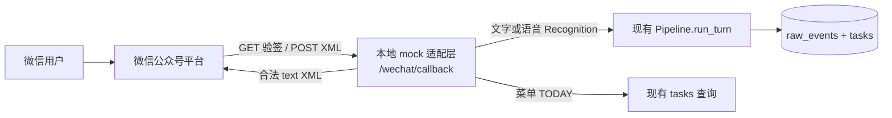
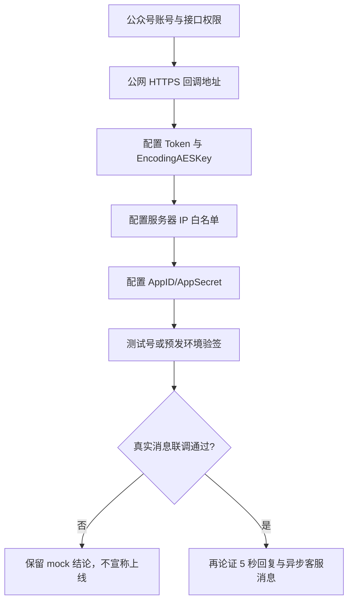
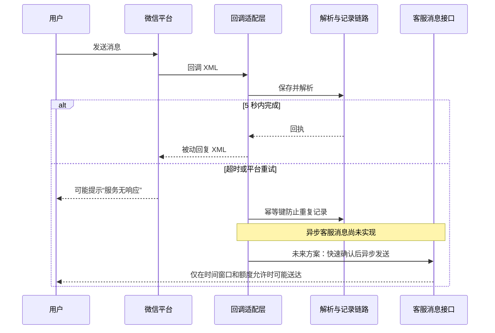

# 公众号接入说明

> 日期：2026-11-16  
> 结论：当前只完成本地 mock 公众号回调适配，没有连接真实微信公众号，也不代表真实公众号已经接通。

## 1. 名词表

| 名词 | 人话解释 |
|---|---|
| 公众号回调 | 用户在公众号发消息后，微信平台把消息转发给我们的服务地址 |
| OpenID | 微信给同一公众号下每个用户的唯一标识；本项目把它映射为 `user_id` |
| Token | 微信平台与业务服务约定的签名校验口令，不是用户登录令牌 |
| AppID | 公众号的唯一应用编号 |
| AppSecret | 调用公众号服务端接口的密钥，泄露后可能被他人冒用 |
| EncodingAESKey | 公众号“安全模式”下消息加解密使用的密钥 |
| 被动回复 | 微信把用户消息转发过来后，业务服务在同一次 HTTP 响应里立即返回的 XML 回复 |
| 客服消息 | 公众号通过服务端接口主动下发的消息，受用户互动后的时间窗口和额度限制 |

## 2. 当前实现范围



| 能力 | 当前状态 |
|---|---|
| `GET /wechat/callback` 签名校验并返回 `echostr` | 已实现，本地 mock |
| `POST /wechat/callback` 接收明文 XML | 已实现，本地 mock |
| 文字消息进入现有记录 pipeline | 已实现 |
| 语音消息读取 `Recognition` 转写文本 | 已实现 |
| 菜单 `TODAY` 查询今日记录 | 已实现，不新增原始事件 |
| `FromUserName -> user_id`、`MsgId -> source_message_id` | 已实现 |
| 重复 `MsgId` 幂等 | 复用 `raw_events` 的唯一约束和缓存回执 |
| 被动回复 XML | 已实现 |
| XML 解析异常时尽量保存原文并解释 | 已实现；缺少用户身份时无法建立可追溯记录 |
| 真实公众号回调、AES 安全模式、客服消息发送 | 未实现 |

当前不支持：

- 微信公众号“安全模式”的 AES 解密和加密回包；
- 获取 `access_token`；
- 调用客服消息接口；
- 真实公众号的 AppSecret、Token、EncodingAESKey 联调；
- 异步队列、重试调度和送达状态追踪。

## 3. 本地 mock 联调

### 3.1 启动服务

`WECHAT_TOKEN` 是本地自拟的随机口令，用于模拟微信平台的签名校验。代码没有默认 Token，也没有把 Token 写入仓库。

```powershell
cd <repository-root>

$env:LLM_MODE = "mock"
$env:WECHAT_TOKEN = [Convert]::ToHexString(
    [Security.Cryptography.RandomNumberGenerator]::GetBytes(24)
).ToLower()

python -m mvp.app --host 127.0.0.1 --port 18765
```

如果未设置 `WECHAT_TOKEN`，公众号回调返回 `503 wechat token is not configured`，不会跳过验签。

### 3.2 生成签名

签名算法与公众号一致：

1. 取 `Token`、`timestamp`、`nonce`；
2. 将三个字符串按字典序排序；
3. 直接拼接；
4. 计算 SHA-1，输出 40 位小写十六进制。

```powershell
function Get-WeChatSignature {
    param(
        [string]$Token,
        [string]$Timestamp,
        [string]$Nonce
    )

    $parts = @($Token, $Timestamp, $Nonce) | Sort-Object
    $bytes = [Text.Encoding]::UTF8.GetBytes(($parts -join ''))
    $sha1 = [Security.Cryptography.SHA1]::Create()
    try {
        -join ($sha1.ComputeHash($bytes) | ForEach-Object {
            $_.ToString('x2')
        })
    }
    finally {
        $sha1.Dispose()
    }
}
```

### 3.3 验证 GET 签名

```powershell
$timestamp = [DateTimeOffset]::UtcNow.ToUnixTimeSeconds().ToString()
$nonce = [Guid]::NewGuid().ToString("N")
$signature = Get-WeChatSignature `
    -Token $env:WECHAT_TOKEN `
    -Timestamp $timestamp `
    -Nonce $nonce

$uri = "http://127.0.0.1:18765/wechat/callback" +
    "?signature=$signature&timestamp=$timestamp&nonce=$nonce&echostr=hello"

(Invoke-WebRequest -Uri $uri).Content
```

成功时返回 `hello`；签名错误时返回 HTTP `403 invalid signature`。

### 3.4 发送文字 XML

POST 请求也要带同一套 `signature/timestamp/nonce` 查询参数。以下示例先在当前 PowerShell 会话中复用上一步的变量。

```powershell
$textXml = @'
<xml>
  <ToUserName><![CDATA[gh_mock_account]]></ToUserName>
  <FromUserName><![CDATA[openid_mock_user]]></FromUserName>
  <CreateTime>1763308800</CreateTime>
  <MsgType><![CDATA[text]]></MsgType>
  <Content><![CDATA[今天背完单词了，论文开头也改了]]></Content>
  <MsgId>mock-msg-1001</MsgId>
</xml>
'@

$timestamp = [DateTimeOffset]::UtcNow.ToUnixTimeSeconds().ToString()
$nonce = [Guid]::NewGuid().ToString("N")
$signature = Get-WeChatSignature `
    -Token $env:WECHAT_TOKEN `
    -Timestamp $timestamp `
    -Nonce $nonce
$uri = "http://127.0.0.1:18765/wechat/callback" +
    "?signature=$signature&timestamp=$timestamp&nonce=$nonce"
$body = [Text.Encoding]::UTF8.GetBytes($textXml)

(Invoke-WebRequest `
    -Method Post `
    -Uri $uri `
    -ContentType "text/xml; charset=utf-8" `
    -Body $body).Content
```

响应是合法的被动回复 XML：

```xml
<xml>
<ToUserName><![CDATA[openid_mock_user]]></ToUserName>
<FromUserName><![CDATA[gh_mock_account]]></FromUserName>
<CreateTime>1763308800</CreateTime>
<MsgType><![CDATA[text]]></MsgType>
<Content><![CDATA[已记下：每日任务：背单词；任务进展：毕业论文。原话已按原文保存。]]></Content>
</xml>
```

### 3.5 语音 XML

语音消息使用 `Recognition` 字段作为原话：

```xml
<xml>
  <ToUserName><![CDATA[gh_mock_account]]></ToUserName>
  <FromUserName><![CDATA[openid_mock_user]]></FromUserName>
  <CreateTime>1763308801</CreateTime>
  <MsgType><![CDATA[voice]]></MsgType>
  <MediaId><![CDATA[mock-media-id]]></MediaId>
  <Format><![CDATA[amr]]></Format>
  <Recognition><![CDATA[今天背完单词了。]]></Recognition>
  <MsgId>mock-msg-1002</MsgId>
</xml>
```

若 `Recognition` 为空，接口会返回可解释的被动回复，但不会伪造一条原话记录。

### 3.6 菜单 TODAY 事件

```xml
<xml>
  <ToUserName><![CDATA[gh_mock_account]]></ToUserName>
  <FromUserName><![CDATA[openid_mock_user]]></FromUserName>
  <CreateTime>1763308802</CreateTime>
  <MsgType><![CDATA[event]]></MsgType>
  <Event><![CDATA[CLICK]]></Event>
  <EventKey><![CDATA[TODAY]]></EventKey>
</xml>
```

接口按上海时区读取该 OpenID 的今日 `tasks` 并生成文字回复。菜单查询是只读操作，不新增 `raw_events`。

### 3.7 重复消息

同一 `FromUserName + MsgId` 继续由现有唯一键 `(user_id, source, source_message_id)` 去重。重复 POST 会返回首次缓存回执，并附加“未重复记录”的提示，不再次解析或创建任务。

### 3.8 运行测试

```powershell
python -m unittest discover -s mvp/tests -v
```

公众号测试覆盖：

- GET 签名成功与失败；
- 文字 XML 映射 `FromUserName/MsgId`；
- 语音 `Recognition`；
- 重复 `MsgId` 幂等；
- 菜单 `TODAY`；
- XML 格式异常时尽量保留原文；
- 原 H5 `/api/utterances` 路径兼容。

## 4. 真实公众号接入前置条件



| 前置条件 | 要求 | 当前状态 |
|---|---|---|
| 公众号账号 | 明确订阅号/服务号、认证状态、消息接收与客服消息权限 | 未确认真实可用性 |
| 公网地址 | 微信平台可访问的 HTTPS 地址，域名与证书有效 | 未准备 |
| 回调地址 | 指向正式服务的 `/wechat/callback` | 仅本地 mock |
| AppID | 公众号应用编号 | 未接入 |
| AppSecret | 服务端调用凭证，必须放 Secrets | 未接入 |
| Token | 回调签名校验口令，必须放 Secrets | 本地 mock 使用随机环境变量 |
| EncodingAESKey | 安全模式加解密密钥，必须放 Secrets | 未接入，当前不支持 AES |
| IP 白名单 | 公众号后台配置调用接口的服务器出口 IP；同时确认微信回调来源和网络边界 | 未配置 |
| 消息模式 | 明文模式可直接联调当前解析；安全模式需先补 AES | 仅支持明文 XML |
| 域名/业务校验 | 如果涉及网页授权或 H5，还需配置业务域名、JS 接口安全域名等 | 未处理 |

## 5. 敏感配置与 Secrets

| 配置 | 是否敏感 | 建议存放 |
|---|---|---|
| `WECHAT_TOKEN` | 是，泄露后可伪造签名 | Secrets / 密钥管理服务 |
| `WECHAT_APP_SECRET` | 是，可调用公众号服务端接口 | Secrets，禁止写入代码、日志、截图、数据库和 Git |
| `WECHAT_ENCODING_AES_KEY` | 是，可解密消息 | Secrets |
| `WECHAT_APP_ID` | 本身是标识，不是密钥 | 普通环境配置；但仍应集中管理，不随日志扩散 |
| `access_token`（运行时获取） | 是，短期凭证 | 仅运行时内存或加密短期缓存，不写日志 |
| 用户 OpenID | 个人标识，属于敏感业务数据 | 数据库访问控制；不输出到普通日志 |
| Cookie | 本项目公众号回调不需要 | 不应出现在代码、日志或仓库 |

上线前应做到：

1. Secrets 由部署环境注入，不提交 `.env`；
2. 日志只记录请求编号、状态和耗时，不记录 Token、AppSecret、EncodingAESKey、`access_token` 或完整用户消息；
3. 错误响应不回显密钥或内部堆栈；
4. 密钥轮换有操作记录，泄露后可立即停用并替换；
5. 本地测试 Token 与真实 Token 完全隔离。

## 6. 5 秒被动回复与客服消息窗口风险

真实公众号的被动回复必须在约 5 秒内返回。当前同步链路包含解析器，配置真实 LLM 时可能超过 5 秒；当前本地 mock 测试通过不等于真实平台时限通过。



必须明确的产品口径：

- 微信平台重试回调时，现有 `MsgId` 幂等可防止重复业务记录；
- 被动回复超时会导致用户看不到回执，即使后台已经保存；
- 客服消息只能在用户互动后的限定窗口内发送，并受额度和接口权限限制；
- “接口调用成功”不等于“用户已看到”；
- 超过窗口、额度不足或接口失败时，不能承诺送达；
- 当前没有异步队列、客服消息发送和送达状态追踪。

正式接入前建议先用测试号实测：回调耗时、平台重试间隔、5 秒边界、48 小时客服消息窗口、额度和失败返回。

## 7. 当前边界声明

- 本分支完成的是本地 mock 适配层与自动化测试；
- 没有调用真实微信公众号接口；
- 没有申请、登录或配置真实公众号；
- 没有验证真实平台的 5 秒、客服消息窗口和 IP 白名单行为；
- 真实接入还需要公网 HTTPS 部署、平台账号权限、Secrets 管理、AES 安全模式支持、异步发送和真机联调。

