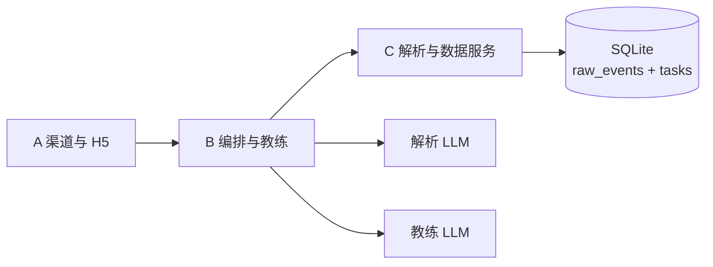

# Architecture Aligned with MVP_SPEC_v1.0

## Responsibility boundaries

This local demo runs A/B/C responsibilities in one process so it can be tested
quickly. The code boundaries still match the spec:

- `app.py`, `wechat.py`, and `web/`: A-facing H5 and WeChat HTTP adapters;
- `pipeline.py` and `coach.py`: B orchestration and coach;
- `parser.py`, `records.py`, `channel.py`, `db.py`: C parsing/data service;
- `llm_client.py`: shared OpenAI-compatible transport.

## Two tables

`raw_events` is append-only. It stores the utterance, correction, clarification,
parse status, parser output, and cached response. `tasks` stores the current
state of task, task progress, and daily task records. There is no correction
table; corrections are new raw events.

## Main flow

1. H5 sends a TurnRequest-like payload to the local HTTP adapter.
2. The adapter calls B orchestration.
3. C stores the raw event before calling the parser.
4. The parser returns only `records` and `clarification`.
5. C validates the parser contract and writes tasks only on success.
6. B builds a deterministic receipt and calls the coach as a non-blocking
   optional step.
7. B caches the final response on the raw event for idempotent replay.
8. The H5 page reads tasks and failed raw events.

## WeChat mock adapter

`wechat.py` owns signature verification, plaintext callback XML parsing,
passive reply XML generation, and the `TODAY` menu query. Text and voice
`Recognition` messages are normalized into the existing
`Pipeline.run_turn(user_id, source='wechat', source_message_id, content)`
contract. The adapter does not write task or event rows directly, and the
business pipeline does not parse WeChat XML.

The current adapter is a local plaintext mock only. It does not implement AES
message encryption, access tokens, customer-service messages, asynchronous
delivery, or a real WeChat account connection.

## Module prompts

The parser prompt identifies itself as C's parser and explicitly forbids A/B
responsibilities. The coach prompt identifies itself as B's coach and forbids
database changes. This keeps model output from silently becoming domain state.

## Default free model

`hy4-flash-free` is the primary model; `longcat-2.5-free` is the fallback.
Both are configured in the OpenCode Go console as free models. The API key is
only read from `OPENCODE_API_KEY`.

